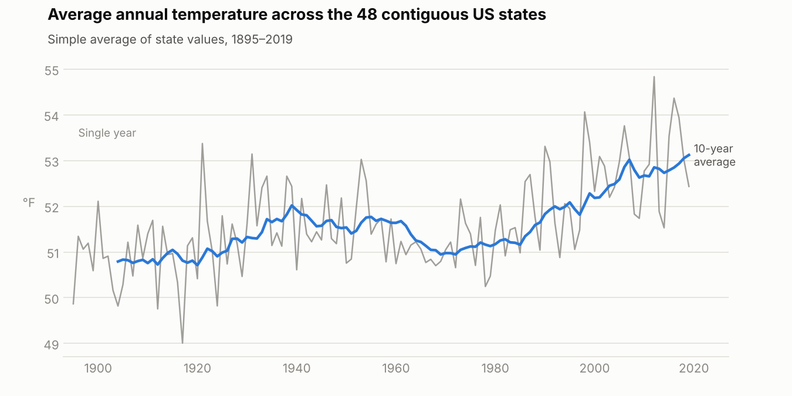
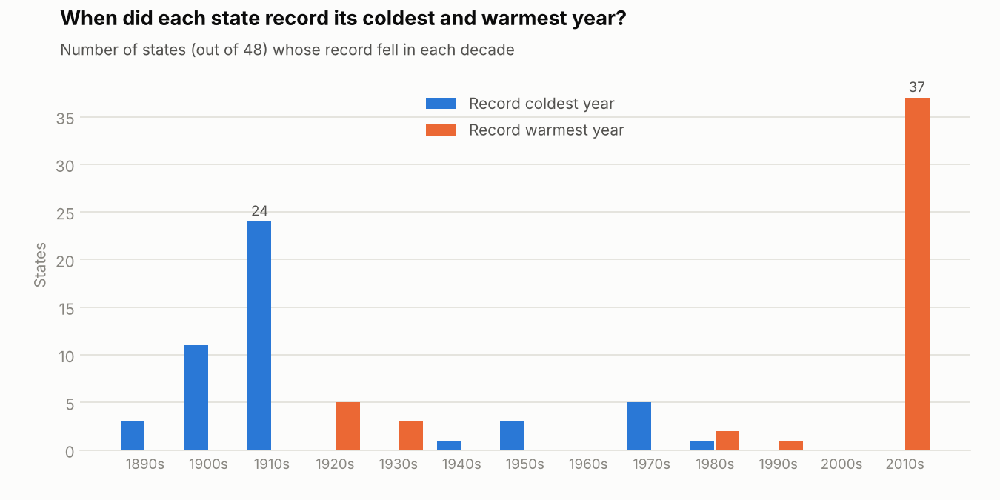

# 02 · Climate Change

Analysing 125 years of average annual temperatures for the 48 contiguous US states, using SQL **window functions** to compare each year against a state's own history and against the rest of the country.

## Dataset

`state_climate`: 6,000 rows, one per state per year, covering **48 states × 1895–2019**. The full table is in [`data/state_climate.csv`](data/state_climate.csv).

| Column | Type | Description |
|---|---|---|
| `state` | TEXT | US state |
| `year` | INTEGER | Year of the reading |
| `tempf` | REAL | Average annual temperature (°F) |
| `tempc` | REAL | Average annual temperature (°C) |

The temperature is the average of every day, across all parts of the state, for that year. The data was provided as part of the course and is based on NOAA's statewide temperature records.

## Questions answered

| # | Question | SQL used |
|---|---|---|
| 1 | What does the data look like? | `SELECT *` |
| 2 | How does each state's average temperature build up over time? | `AVG() OVER (PARTITION BY … ORDER BY …)` |
| 3 | What is each state's lowest recorded temperature? | `FIRST_VALUE()` |
| 4 | What is each state's highest recorded temperature? | `FIRST_VALUE()` with descending order |
| 5 | Which states and years had the biggest year-on-year changes? | `LAG()`, subquery, `IS NOT NULL` |
| 6 | Which were the coldest years nationwide? | `RANK()` |
| 7 | Which were the warmest years in each state? | `RANK()` with `PARTITION BY` |
| 8 | How do each state's years split into quartiles? | `NTILE(4)` per state |
| 9 | How do all years split into quintiles nationwide? | `NTILE(5)` across all states |
| 10–12 | *Extra:* record years per state, 10-year rolling average, averages by era | `ROW_NUMBER()`, window frame (`ROWS BETWEEN`), `CASE` + `GROUP BY` |

All queries are in [`queries.sql`](queries.sql).

## Findings

**Record lows are historic and record highs are recent (Q3, Q4).**
39 of the 48 states recorded their coldest year before 1950, and 1917 alone holds the record low for 16 states. In contrast, 37 states set their warmest year in the 2010s, including 26 states in 2012 alone. No state's record low falls after the 1980s.

**The biggest year-on-year swings are in the Upper Midwest (Q5).**
The largest changes were Minnesota in 2013 (−5.9 °F), Wisconsin in 2013 (−5.6 °F), Minnesota in 1932 (−5.5 °F), Iowa in 2013 (−5.4 °F) and North Dakota in 1982 (−5.4 °F). Most of the top 15 results are in Minnesota, Wisconsin, Iowa or the Dakotas. These inland, northern states are far from the moderating effect of the oceans, so their temperatures swing more from year to year. Many of the 2013 drops are a return to normal after the record-warm 2012.

**The coldest years on record are almost all historic (Q6).**
Nationally, the coldest year was North Dakota in 1950 (34.9 °F), followed by North Dakota in 1951 and Minnesota in 1917. Nine of the ten coldest state-years happened before 1952; the only recent entry is North Dakota in 1996.

**Each state's warmest years are recent (Q7).**
Across all states, 78% of each state's five warmest years have occurred since 1990, even though 1990–2019 makes up only 24% of the years in the data.

**Ranked within each state, the coldest quartile is mostly early-century (Q8).**
58% of the years in each state's coldest quartile are before 1950, and only 6% are from 1990 onwards. The warmest quartile is the reverse: 55% of its years are from 1990 onwards.

**Ranked nationally, the coldest quintile is about geography, not time (Q9).**
Without `PARTITION BY`, the question changes from "which were each state's cold years?" to "which state-years were coldest overall?". Only 16 of the 48 states appear in the coldest quintile at all, and it is dominated by northern and mountain states: Maine (123 of its 125 years), Wyoming (122), North Dakota (121) and Minnesota (119). Southern states such as Florida and Texas never appear, even in their coldest years. The share of pre-1950 years in this quintile falls to 49%, because location now matters more than era.

**Overall trend (Q11, Q12).**
The average across states was 51.2 °F in 1895–1949, 51.3 °F in 1950–1989 and 52.7 °F in 1990–2019, an increase of about 1.4 °F, with most of the warming since the 1980s. *(This is a simple average of state values, not weighted by area.)*

## Key takeaways

- `PARTITION BY` decides which group a window function works within. Removing it (Q9 vs Q8) changes the question being answered, and therefore the answer.
- `LAG()` compares a row with the one before it, which is the standard way to calculate period-on-period change.
- `LAST_VALUE()` can return unexpected results with the default window frame, so `FIRST_VALUE()` with a reversed sort is a simpler way to get a maximum.
- `RANK()` gives a position, while `NTILE()` groups rows into equal-sized buckets, which suits "top 25%"-style questions.
- Context matters when reading results: a share only means something when compared with what you'd expect by chance (e.g. 78% of warmest years vs 24% of all years).

## Skills demonstrated

Window functions · `OVER` · `PARTITION BY` · window frames (`ROWS BETWEEN`) · `AVG()` · `FIRST_VALUE()` · `LAG()` · `RANK()` · `ROW_NUMBER()` · `NTILE()` · subqueries · `CASE` · `GROUP BY` · data visualisation
